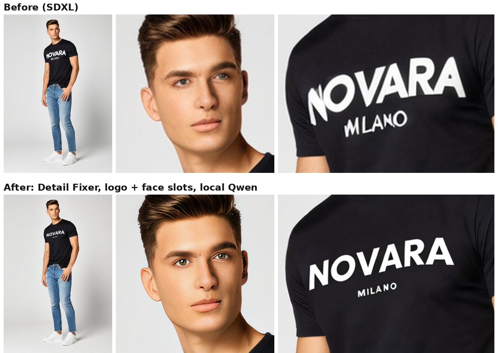

# ComfyUI Detail Fixer

Generated photos are often great except for one detail: a **garbled logo**, **odd eyes**, a **broken hand**. Detail Fixer finds each problem area with SAM 3, **regenerates only that area** with an image-edit model (optionally guided by a reference image), and blends it back into the original photo. Everything outside the fixed areas stays pixel-identical.

Runs fully locally on a 10 GB GPU (SAM 3 + Qwen Image Edit 2509 GGUF), or regenerate with **Nano Banana 2** or **GPT Image 2** through ComfyUI's built-in API nodes, chosen per slot.



## How it works

The example workflow is a chain of **fix slots**. Each slot:

1. **Finds** its target with SAM 3 from a word or two (`logo` + `text`, `face`, `hand`, `jeans`...). Touching boxes are merged, so a brand name and its tagline are fixed as one piece.
2. **Crops** a high-resolution patch with surrounding context, plus the object's outline from SAM 3.
3. **Regenerates** just that area with an edit model and your instruction, optionally with a reference image (your logo, a photo of the person, a fabric swatch). Logo slots first erase the old print and start from a faint guide of your logo, so the model redraws it in the right place.
4. **Blends back** into the photo along the object's outline, optionally colour-matched to the original (faces and skin).

Slots run one after another: **Logo → Face → Custom**. In each slot a **Detail Pick Model** node chooses `skip`, `local` (Qwen), `api 1` (Nano Banana 2) or `api 2` (GPT Image 2). Only the chosen branch runs, so API credits are only spent when you pick an API.

The photo is upscaled 2x first (4x-UltraSharp at half scale), so small details like a chest logo or eyes in a full-length shot get enough pixels.

## Nodes

| Node | What it does |
|---|---|
| **Detail Detect** | Boxes, mask and preview. `sam3`: connect the bboxes of one or two **SAM3 Detect** nodes (local). `gemini`: free Gemini API, describe the target. `manual`: type boxes. `merge_touching` joins touching boxes. |
| **Detail Crop** | One upscaled crop per detection, as a **list** (the edit model runs once per detection). Outputs a `box_mask` and, if you connect SAM 3's masks, a `shape_mask` with the object's outline. If nothing is found, the slot passes the photo through unchanged. |
| **Detail Prepare Logo** | Logo slots: `erase_original` removes the old print and keeps the fabric; `opacity` 0 gives the clean crop the model looks at, ~0.6 gives the faint placement guide it starts from. Takes a transparent PNG through `reference_mask`. |
| **Detail Paste Back** | Blends every regenerated crop back. `blend_mask` = blend exactly the regenerated area; `match_color` = match colour and contrast to the original. |
| **Detail Pick Model** | Per-slot switch: `skip` / `local` / `api 1` / `api 2`. Lazy: unselected branches don't run. |

## Install

```
cd ComfyUI/custom_nodes
git clone https://github.com/Somarawad/ComfyUI-DetailFixer
```
Restart ComfyUI. No extra Python packages.

## Example workflow

Drag `examples/detail_fixer.json` into ComfyUI, load your photo, and for the logo slot load your logo twice (as a reference image and as a transparent PNG). Queue.

| Model | Folder |
|---|---|
| `sam3.1_multiplex_fp16.safetensors` ([Comfy-Org/sam3](https://huggingface.co/Comfy-Org/sam3)) | `models/checkpoints` |
| `Qwen-Image-Edit-2509-Q3_K_S.gguf` (loaded with the [gguf](https://github.com/calcuis/gguf) nodes) | `models/unet/gguf` |
| `Qwen-Image-Edit-2509-Lightning-4steps-V1.0-bf16.safetensors` | `models/loras` |
| `qwen_2.5_vl_7b_fp8_scaled.safetensors` | `models/text_encoders` |
| `qwen_image_vae.safetensors` | `models/vae` |
| `4x-UltraSharp.pth` | `models/upscale_models` |

API branches use ComfyUI's built-in partner nodes and your Comfy.org credits (sign in under Settings).

## Suggested settings

| Slot | Find | Strength (denoise) | Notes |
|---|---|---|---|
| Logo | `logo` + `text` | 0.7-0.8 | erase + guide on; reference = your logo |
| Face | `face` | 0.35-0.45 | outline blend + colour match; optional face reference |
| Hands | `hand` | 0.4-0.5 | outline blend + colour match |
| Clothing | `jeans`, `jacket`... | 0.4-0.6 | describe the fix ("remove the extra pocket") |

## Tips

- Higher strength = more change. If a result is off, try another seed.
- Logo drifts or gets clipped: lower the logo strength or raise the guide opacity.
- The edit model ignores the instruction: raise `context` in Detail Crop; on very tight crops edit models tend to copy their input.
- For a dark garment, use a light version of your logo (and vice versa) for the guide.
- Only use logos and likenesses you have the rights to use.

## Tests

```
python -m pytest tests
```

## License

MIT
